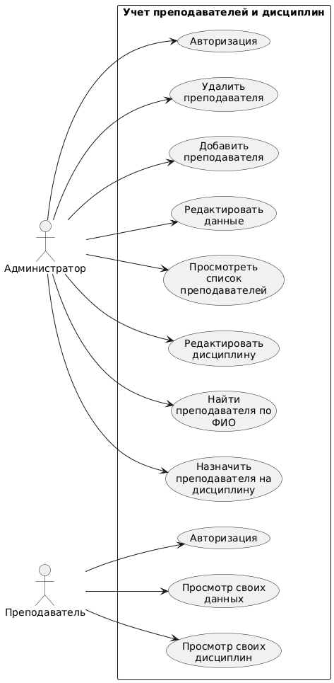
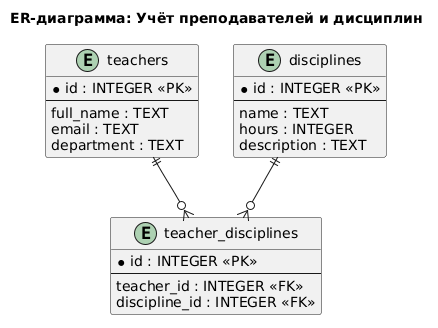

# MyProject

## Описание

**Учебный проект** для лабораторной работы №2 по дисциплине «Информатика».

Программа представляет собой *систему учета преподавателей и дисциплин*. 
Основная задача проекта — демонстрация навыков работы с системой контроля версий Git, 
платформой GitHub и языком разметки Markdown.

## Автор

**Иветьев Роман**

## Как запустить

1. Установите Python версии 3.10 или выше.
2. Склонируйте репозиторий на свой компьютер:
   ```bash
   git clone https://github.com/retttox/MyProject.git
      ```
3. Перейдите в папку проекта и запустите программу:
   ```bash
   python main.py
   ```

## Диаграмма Use Case

Ниже представлена диаграмма вариантов использования системы учета преподавателей и дисциплин,
построенная с помощью языка **PlantUML**:



### ER-диаграмма базы данных



### Описание структуры базы данных

#### Таблица `teachers` (Преподаватели)

| Атрибут | Тип данных | Ключ | Описание |
| :--- | :--- | :--- | :--- |
| `id` | INTEGER | **PK** | Уникальный идентификатор |
| `full_name` | TEXT | | ФИО преподавателя |
| `email` | TEXT | | Электронная почта |
| `department` | TEXT | | Кафедра |

#### Таблица `disciplines` (Дисциплины)

| Атрибут | Тип данных | Ключ | Описание |
| :--- | :--- | :--- | :--- |
| `id` | INTEGER | **PK** | Уникальный идентификатор |
| `name` | TEXT | | Название дисциплины |
| `hours` | INTEGER | | Количество часов |
| `description` | TEXT | | Описание дисциплины |

#### Таблица `teacher_disciplines` (Связующая таблица)

| Атрибут | Тип данных | Ключ | Описание |
| :--- | :--- | :--- | :--- |
| `id` | INTEGER | **PK** | Уникальный идентификатор записи |
| `teacher_id` | INTEGER | **FK** | Ссылка на `teachers.id` |
| `discipline_id` | INTEGER | **FK** | Ссылка на `disciplines.id` |

**Типы связей:**

- `teachers` и `disciplines` — связь **многие-ко-многим (M:N)**.
- Связь реализована через промежуточную таблицу `teacher_disciplines`, которая имеет связи **один-ко-многим (1:N)** с обеими основными таблицами.

**Обозначения:**
- **PK (Primary Key)** — первичный ключ, уникально идентифицирующий запись.
- **FK (Foreign Key)** — внешний ключ, связывающий запись с другой таблицей.

## Основные команды Git

| Команда | Назначение |
|---------|------------|
| `git init` | Инициализация локального репозитория |
| `git add .` | Добавление файлов в индекс |
| `git commit -m "..."` | Создание коммита с сообщением |
| `git push` | Отправка изменений на GitHub |
| `git pull` | Получение изменений с GitHub |

## Структура проекта

- `main.py` — исходный код программы
- `README.md` — документация проекта
- `docs/diagrams/` — папка с диаграммами (исходник `.puml` и картинка `.png`)

## Полезные ссылки

- [Официальная документация Git](https://git-scm.com/doc)
- [Официальная документация GitHub](https://docs.github.com)
- [Сайт PlantUML](https://plantuml.com)
- [Мой профиль на GitHub](https://github.com/retttox)
