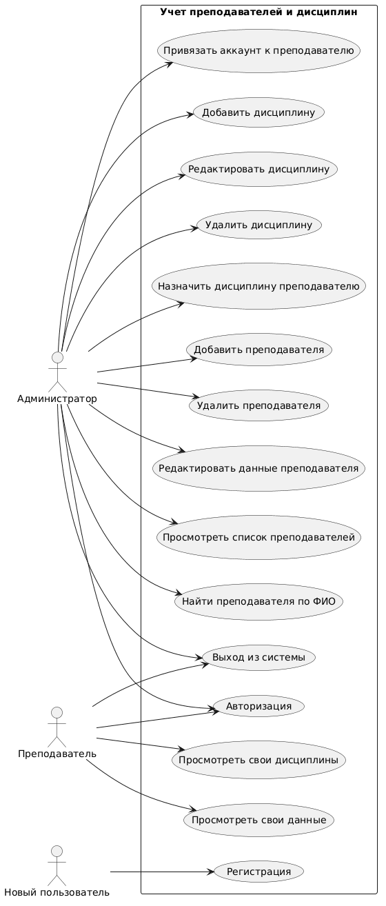
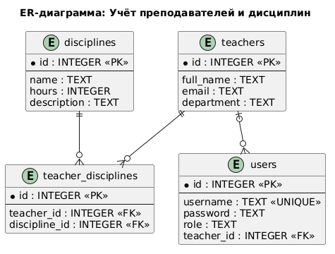

# MyProject

## Описание

Учебный проект для лабораторной работы №4 по дисциплине «Информатика».

Программа представляет собой систему учёта преподавателей и дисциплин. Она позволяет хранить информацию о преподавателях, дисциплинах, назначать дисциплины преподавателям, а также выполнять основные операции с данными.

В проекте реализованы:
- работа с базой данных SQLite;
- модели данных;
- репозитории для взаимодействия с базой данных;
- сервисы для реализации бизнес-логики;
- консольный пользовательский интерфейс;
- регистрация и авторизация пользователей;
- разделение прав администратора и преподавателя.

## Автор

**Иветьев Роман**

## Как запустить

1. Установите Python версии 3.10 или выше.
2. Склонируйте репозиторий:

   ```bash
   git clone https://github.com/retttox/MyProject.git
   ```

3. Перейдите в папку проекта:

   ```bash
   cd MyProject
   ```

4. Создайте базу данных:

   ```bash
   python database.py
   ```

5. Запустите программу:

   ```bash
   python main.py
   ```

6. При первом запуске зарегистрируйте пользователя. Первый зарегистрированный пользователь получает роль администратора. Последующие пользователи регистрируются как преподаватели и выбирают свои данные из списка.

## Возможности программы

### Администратор

Администратор может:
- просматривать список преподавателей;
- добавлять, изменять и удалять преподавателей;
- просматривать список дисциплин;
- добавлять, изменять и удалять дисциплины;
- назначать дисциплины преподавателям;
- искать преподавателей по ФИО;
- привязывать аккаунты к преподавателям.

### Преподаватель

Преподаватель может:
- просматривать свои личные данные;
- просматривать назначенные ему дисциплины.

## Структура проекта

```text
MyProject/
│
├── models/
│   ├── teacher.py
│   ├── discipline.py
│   ├── teacher_discipline.py
│   └── user.py
│
├── repositories/
│   ├── teacher_repository.py
│   ├── discipline_repository.py
│   ├── teacher_discipline_repository.py
│   └── user_repository.py
│
├── services/
│   ├── teacher_service.py
│   ├── discipline_service.py
│   ├── teacher_discipline_service.py
│   └── auth_service.py
│
├── docs/
│   └── diagrams/
│       ├── use_case.puml
│       ├── use_case.png
│       ├── er_diagram.puml
│       └── er_diagram.png
│
├── database.py
├── main.py
├── teachers.db
├── .gitignore
└── README.md
```

### Назначение основных папок и файлов

- `models/` — модели данных, используемые в программе.
- `repositories/` — классы для получения, добавления, изменения и удаления данных в базе.
- `services/` — бизнес-логика и проверка введённых данных.
- `docs/diagrams/` — диаграммы проекта.
- `database.py` — создание базы данных и таблиц.
- `main.py` — основной файл программы и консольное меню.
- `teachers.db` — база данных SQLite.
- `.gitignore` — список файлов и папок, которые не нужно добавлять в Git.

## Структура базы данных

В проекте используется SQLite.

### Таблица `teachers` (Преподаватели)

| Атрибут | Тип данных | Ключ | Описание |
|---|---|---|---|
| `id` | INTEGER | PK | Уникальный идентификатор |
| `full_name` | TEXT | | ФИО преподавателя |
| `email` | TEXT | | Электронная почта |
| `department` | TEXT | | Кафедра |

### Таблица `disciplines` (Дисциплины)

| Атрибут | Тип данных | Ключ | Описание |
|---|---|---|---|
| `id` | INTEGER | PK | Уникальный идентификатор |
| `name` | TEXT | | Название дисциплины |
| `hours` | INTEGER | | Количество часов |
| `description` | TEXT | | Описание дисциплины |

### Таблица `teacher_disciplines` (Связующая таблица)

| Атрибут | Тип данных | Ключ | Описание |
|---|---|---|---|
| `id` | INTEGER | PK | Уникальный идентификатор |
| `teacher_id` | INTEGER | FK | Ссылка на `teachers.id` |
| `discipline_id` | INTEGER | FK | Ссылка на `disciplines.id` |

### Таблица `users` (Пользователи)

| Атрибут | Тип данных | Ключ | Описание |
|---|---|---|---|
| `id` | INTEGER | PK | Уникальный идентификатор |
| `username` | TEXT | UNIQUE | Логин пользователя |
| `password` | TEXT | | Пароль |
| `role` | TEXT | | Роль пользователя |
| `teacher_id` | INTEGER | FK | Ссылка на `teachers.id` |

### Типы связей

- `teachers` и `disciplines` — связь многие-ко-многим (M:N).
- Для реализации связи используется промежуточная таблица `teacher_disciplines`.
- `users` связана с `teachers` через поле `teacher_id`.

**Обозначения:**
- PK (Primary Key) — первичный ключ.
- FK (Foreign Key) — внешний ключ.
- UNIQUE — уникальное значение.

## Диаграммы проекта

### Диаграмма Use Case

Диаграмма показывает основные действия администратора и преподавателя в системе.



### ER-диаграмма

ER-диаграмма показывает структуру базы данных и связи между таблицами.



## Основные команды Git

| Команда | Назначение |
|---|---|
| `git init` | Инициализация локального репозитория |
| `git add .` | Добавление файлов в индекс |
| `git commit -m "..."` | Создание коммита |
| `git push` | Отправка изменений на GitHub |
| `git pull` | Получение изменений с GitHub |

## Полезные ссылки

- [Документация Git](https://git-scm.com/doc)
- [Документация GitHub](https://docs.github.com)
- [Сайт PlantUML](https://plantuml.com)
- [Мой профиль GitHub](https://github.com/retttox)
- [Репозиторий проекта](https://github.com/retttox/MyProject)
